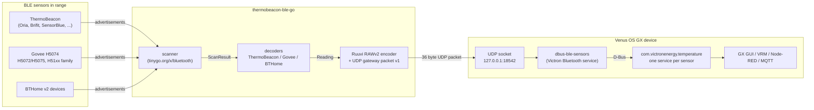

# thermobeacon-ble-go

[](https://github.com/prune998/thermobeacon-ble-go/actions/workflows/test.yml)
[](https://github.com/prune998/thermobeacon-ble-go/releases)

A Go port of [WookyDO/dbus-ble-temp](https://github.com/WookyDO/dbus-ble-temp): it shows
**ThermoBeacon** Bluetooth thermometers/hygrometers (Oria, Brifit, SensorBlue and other
clones), [BTHome v2](https://bthome.io/) devices and **Govee** thermometers (H5074 and
friends) on Victron **Venus OS** GX devices (Cerbo GX, Ekrano GX, ...) as native
temperature sensors — in the GUI, on VRM, and in Node-RED/MQTT.

Built with [tinygo.org/x/bluetooth](https://github.com/tinygo-org/bluetooth)
(CoreBluetooth on macOS, BlueZ on Linux, WinRT on Windows) and
[hybridgroup/go-bthome](https://github.com/hybridgroup/go-bthome) for BTHome payloads.

| Supported devices | Identification |
|---|---|
| ThermoBeacon (Oria, Brifit, SensorBlue, ... clones) | company id `0x0010/0x0011/0x0015` + embedded MAC; temp, humidity, battery mV, uptime, button |
| Govee H5074, H5072/H5075/H5129, H5101/H5102/H5104/H5108/H5174/H5177/GV5179 | company id `0xEC88`/`0x0001`; temp, humidity, battery % |
| BTHome v2 devices (Shelly BLU, DIY, ...) | service data `0xFCD2`; temp, humidity, battery/voltage, battery-low |

## How it works

`thermobeacon-ble-go` scans passively, decodes the broadcasts and hands the readings to
Victron's own Bluetooth sensor service (`dbus-ble-sensors`) through its UDP gateway
socket. Victron has no decoder for these devices, so the readings are re-encoded as
**RuuviTag data format 5 ("RAWv2")** — sensors appear as product *RuuviTag* with a
`ruuvi_<mac>` device id; identify yours by MAC or with the `dump` subcommand.



The program itself never talks D-Bus: it sends UDP packets, and `dbus-ble-sensors` does
everything a user sees — sensor list, enable/disable, names, timeouts, alarms. The full
internals, byte formats and the D-Bus path are documented in
[docs/how-it-works.md](docs/how-it-works.md) (with diagrams).

## Installation

**Prebuilt binaries** — push a tag like `v0.1.0` and GitHub Actions builds and publishes
a release with:

| Asset | For |
|---|---|
| `thermobeacon-ble-go-<v>-darwin-arm64.zip` | Apple Silicon Macs |
| `thermobeacon-ble-go-<v>-darwin-amd64.zip` | Intel Macs |
| `thermobeacon-ble-go-<v>-linux-amd64.tar.gz` | x86-64 Linux hosts |
| `thermobeacon-ble-go-<v>-linux-arm64.tar.gz` | Ekrano GX, Raspberry Pi 4/5, ... |
| `thermobeacon-ble-go-<v>-linux-armv7.tar.gz` | Cerbo GX (armv7) |
| `SHA256SUMS.txt` | checksums for all assets |

Every asset contains the `thermobeacon-ble-go` binary; verify with
`sha256sum -c SHA256SUMS.txt`. On macOS, Gatekeeper may block an unsigned
downloaded binary — remove the quarantine flag once with
`xattr -d com.apple.quarantine thermobeacon-ble-go` (or build from source below).
`thermobeacon-ble-go -version` prints the release version.

**From source** — see Usage below and [docs/development.md](docs/development.md).

## Usage

```
go build -o thermobeacon-ble-go .
./thermobeacon-ble-go                          # follow the default device
./thermobeacon-ble-go dump                     # discover: dump every advertisement, no forwarding
./thermobeacon-ble-go -device all              # decode every supported device in range
./thermobeacon-ble-go -no-forward              # just log readings, no UDP
./thermobeacon-ble-go -device AA:BB:CC:DD:EE:FF -udp-host 127.0.0.1 -udp-port 18542
./thermobeacon-ble-go list                     # print the seen-sensor table (sensors.json)
```

The default `-device` is `10243784-1324-5413-b00c-9675981a8daa` (a CoreBluetooth
peripheral UUID). On macOS devices have no MAC address — they are identified by such an
UUID, which is stable for a given sensor on a given Mac. Find yours with
`./thermobeacon-ble-go dump`. On Linux pass the MAC address instead.

### Subcommands

| Command | Meaning |
|---|---|
| *(none)* | scan and forward readings |
| `dump` | scan and dump **every** advertisement in a meaningful way — decode + log only, no UDP; lifts the default device filter unless `-device` is given |
| `list` | print the seen-sensor table from the state file |

### Flags

| Flag | Default | Meaning |
|---|---|---|
| `-device` | `10243784-...-9675981a8daa` | UUID (macOS), MAC (Linux) or `all` |
| `-udp-host` / `-udp-port` | `127.0.0.1` / `18542` | dbus-ble-sensors UDP gateway socket |
| `-no-forward` | off | decode and log only, never send UDP packets |
| `-min-interval` | `5s` | at most one forwarded packet per sensor every N seconds |
| `-idle-warning` | `2m` | warn when no BLE advertisement at all was seen for N seconds |
| `-state` | `sensors.json` | seen-sensor record (`''` disables; read by `list`) |
| `-debug` | off | log every advertisement and dump its payload in a meaningful way |

## Debugging

With `-debug` (or the `dump` subcommand) every advertisement of a followed device is
logged with a hex dump and a field-by-field breakdown — raw AD structures when the
platform exposes them (Linux), ThermoBeacon/Govee fields including *why* a payload is
not accepted, BTHome TLVs including ones go-bthome cannot convert, and the forwarded
RuuviTag RAWv2 packet:

```
DEBUG advertisement 10243784-1324-5413-b00c-9675981a8daa rssi -52 dBm, name "Oria"
DEBUG   manufacturer data: company id 0x0010, known ThermoBeacon model, 18 byte payload:
DEBUG     0000  80 00 21 0f a0 8d 5c db  40 0b 34 01 a0 03 0f 87  ..!...\.@.4.....
DEBUG     0010  20 00                                              .
DEBUG     ThermoBeacon decoded: db:5c:8d:a0:0f:21: 19.25 degC, 58.00 %, 2880 mV, uptime 2131727 s
DEBUG     0-1    flags        0x0080  button pressed
DEBUG     2-7    MAC (LSB)    21 0f a0 8d 5c db  -> db:5c:8d:a0:0f:21
DEBUG     8-9    battery      0x0b40  2880 mV (2.880 V)
DEBUG     10-11  temperature  0x0134  308 x 1/16 degC = 19.2500 degC
DEBUG     12-13  humidity     0x03a0  928 x 1/16 % = 58.0000 %
DEBUG     14-17  uptime       0x0020870f  2131727 s (24d 16h 8m 47s)
DEBUG   service data 0000fcd2-0000-1000-8000-00805f9b34fb, 14 bytes:
DEBUG     0000  40 45 d7 00 03 62 11 01  57 15 01 3d 05 00        @E...b..W..=..
DEBUG     device information 0x40 (BTHome v2, unencrypted)
DEBUG     type 0x45  temperature    2 byte  d7 00  -> 21.5 °C
DEBUG     type 0x03  humidity       2 byte  62 11  -> 44.50 % (raw 4450 x 0.01)
DEBUG     type 0x01  battery        1 byte  57  -> 87 %
DEBUG     type 0x15  battery        1 byte  01  -> true
DEBUG     type 0x3d  count          2 byte  05 00  -> not convertible by go-bthome
DEBUG forwarded db:5c:8d:a0:0f:21: ... (36 byte packet)
DEBUG ruuvi RAWv2 payload, 24 bytes:
DEBUG   0000  05 0f 0a 5a a0 ff ff 80  00 80 00 80 00 a0 1f ff  ...Z............
DEBUG   0010  87 0f db 5c 8d a0 0f 21                           ...\...!
DEBUG   format       5 (RAWv2)
DEBUG   temperature  19.2500 degC (raw 3850)
DEBUG   humidity     58.0000 % (raw 23200)
DEBUG   pressure     invalid (0xFFFF)
DEBUG   acceleration x/y/z invalid (0x8000)
DEBUG   battery      2880 mV
DEBUG   tx power     invalid (0x1F)
DEBUG   movement     invalid (0xFF)
DEBUG   sequence     34575 (0x870f)
DEBUG   MAC          db:5c:8d:a0:0f:21
```

A Govee H5074 looks like this:

```
DEBUG advertisement f1ae0297-b710-1440-2881-9274ad58590d rssi -58 dBm, name "Govee_H5074"
DEBUG   manufacturer data: company id 0xec88, Govee company id, 7 byte payload:
DEBUG     0000  01 d3 08 d7 11 58 0a                              .....X.
DEBUG     Govee H5074 decoded: 22.59 degC, 45.67 %, battery 88 %
DEBUG     0      reserved     01
DEBUG     1-2    temperature  d3 08  -> 2259 / 100 = 22.59 degC
DEBUG     3-4    humidity     d7 11  -> 4567 / 100 = 45.67 %
DEBUG     5      battery      58  -> 88 %
DEBUG     6      reserved     0a
```

## Platform notes

**macOS**

- The first run triggers the **Bluetooth permission** prompt for your terminal app (or
  whitelist it in System Settings → Privacy & Security → Bluetooth).
- CoreBluetooth coalesces *identical* advertisements; the supported sensors change their
  payload with every broadcast, so every broadcast arrives.
- Sensors without an embedded MAC (Govee, BTHome) get a stable pseudo MAC derived from
  the device UUID.

**Victron GX device**

- `dbus-ble-sensors` must be running with *Bluetooth sensors* enabled; its gateway socket
  defaults to `127.0.0.1:18542` (loopback only), so either run this program **on the GX**
  (Linux build, `-device <MAC>`) or rebind the socket and point `-udp-host` at it. A full
  walk-through for the Cerbo GX — binary install under `/data`, autostart after boot via
  daemontools and `/data/rc.local`, logs and updates — is in
  [docs/venusos-cerbogx.md](docs/venusos-cerbogx.md).
- With *Continuous scanning* off, the GX only receives about one in six broadcasts.
- Enable the sensor once in **Settings → Integrations → Bluetooth sensors**; it appears
  as *RuuviTag* in the device list.
- While *Bluetooth sensors* is disabled nothing scans and no data arrives — the program
  logs an idle warning after `-idle-warning`.

## Documentation

- [How it works](docs/how-it-works.md) — architecture, app internals and data path to
  Victron's D-Bus (with diagrams), scanning and sensor identity, all byte formats
  (ThermoBeacon, Govee, BTHome, RuuviTag RAWv2, UDP gateway packet), sequence numbers,
  the state file, limitations
- [Running on a Cerbo GX (Venus OS)](docs/venusos-cerbogx.md) — install the `linux-armv7`
  binary under `/data`, start it at boot via daemontools + `/data/rc.local`, logs,
  enabling sensors in the GUI, updating and uninstalling
- [Development](docs/development.md) — requirements and building per platform, the test
  suite, project layout, how to add a new sensor format, debugging tools

## Development

```
go test ./...     # decoder/encoder tests, incl. vectors from the original Python code
go vet ./...
go build -o thermobeacon-ble-go .
```

See [docs/development.md](docs/development.md) for platform requirements, the project
layout and a guide to adding new sensor formats.

## Credits

- [WookyDO/dbus-ble-temp](https://github.com/WookyDO/dbus-ble-temp) — the original Python
  implementation; the ThermoBeacon layout, Ruuvi RAWv2 encoding and UDP packet format are
  ports of it.
- [rnlgreen/thermobeacon](https://github.com/rnlgreen/thermobeacon) — ThermoBeacon
  decoding research the original is based on.
- [tinygo-org/bluetooth](https://github.com/tinygo-org/bluetooth) and
  [hybridgroup/go-bthome](https://github.com/hybridgroup/go-bthome).
- [Bluetooth-Devices/govee-ble](https://github.com/Bluetooth-Devices/govee-ble) —
  reference for the Govee payload layouts.
- [victronenergy/dbus-ble-sensors](https://github.com/victronenergy/dbus-ble-sensors) —
  the receiving end on Venus OS.
