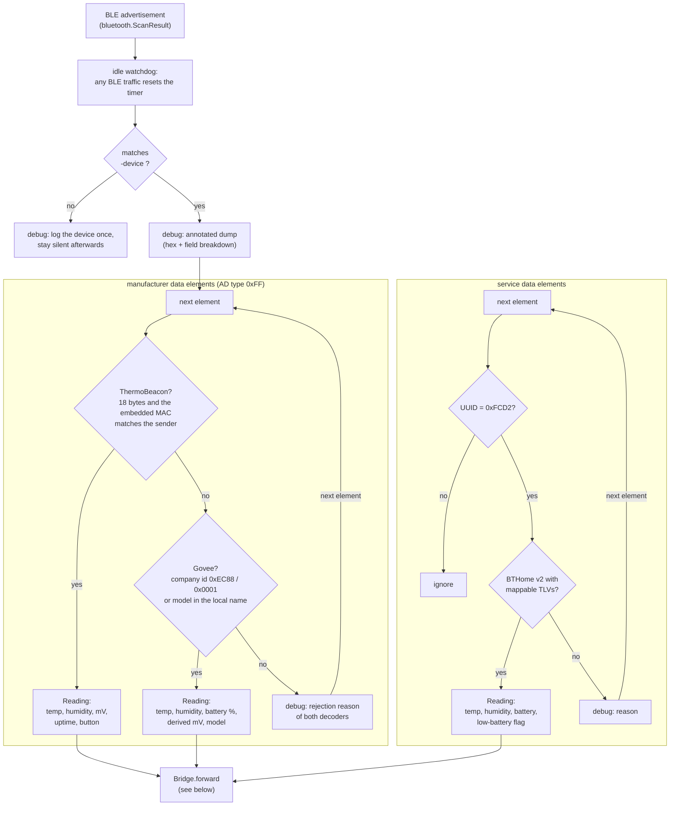
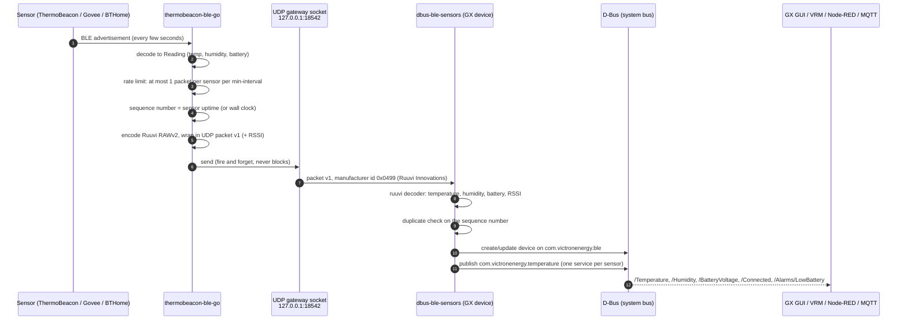
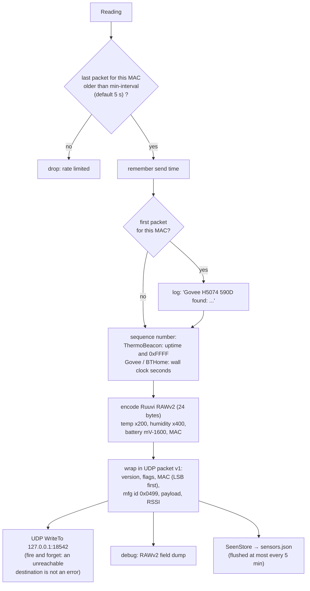

# How it works

This document describes the internals of `thermobeacon-ble-go`: how it scans,
decodes advertisements, re-encodes them and hands them to Victron's
`dbus-ble-sensors`, which owns everything D-Bus related on the GX device.

- [Overview](#overview)
- [App internals](#app-internals)
- [Data path to Victron's D-Bus](#data-path-to-victrons-d-bus)
- [Forwarding pipeline](#forwarding-pipeline)
- [Scanning and sensor identity](#scanning-and-sensor-identity)
- [Decoded formats](#decoded-formats)
- [The RuuviTag RAWv2 packet](#the-ruuvitag-rawv2-packet)
- [The UDP gateway packet](#the-udp-gateway-packet)
- [On the GX device: dbus-ble-sensors](#on-the-gx-device-dbus-ble-sensors)
- [Sequence numbers and duplicates](#sequence-numbers-and-duplicates)
- [Supporting state](#supporting-state)
- [Limitations](#limitations)

## Overview

```
 ThermoBeacon ─┐
 Govee H5074  ─┼─BLE broadcasts─▶ Bluetooth adapter of the host
 BTHome v2    ─┘                        │
                    thermobeacon-ble-go scans, decodes, re-encodes
                                       │
                        UDP packet v1, RuuviTag format 5
                                       ▼
        dbus-ble-sensors  ▶  D-Bus  ▶  GUI / VRM / Node-RED / MQTT
```

`thermobeacon-ble-go` never publishes anything itself: it is a *gateway* that
hands decoded readings to Victron's own Bluetooth sensor service through its
UDP gateway socket (`/Settings/BleSensors/Socket/*`, default `127.0.0.1:18542`).
Everything a user sees — the sensor list, the enable switch, names, alarms,
VRM — is Victron code running on the GX device.

Because `dbus-ble-sensors` has no decoder for ThermoBeacon, Govee or BTHome
sensors, the readings are re-encoded as **RuuviTag data format 5 ("RAWv2")**,
an open format of a sensor type Victron supports. The sensors therefore show
up as product *RuuviTag* with a `ruuvi_<mac>` device id.

## App internals

One process, one scan loop. Everything runs through `Bridge.HandleScan`, the
callback of `adapter.Scan`:



Details:

- **First decoder wins.** The ThermoBeacon decoder runs first (its signature:
  exactly 18 bytes of manufacturer data whose embedded MAC matches the
  advertiser), then the Govee decoder. If a manufacturer element produces a
  reading, the packet is forwarded and the rest of the advertisement is not
  examined. Only when no manufacturer element matched are the service data
  elements tried for BTHome.
- **Device filter.** `-device` accepts a CoreBluetooth UUID (macOS), a MAC
  address (Linux/Windows) or `all`. Everything else is logged once per device
  and then ignored silently.
- **Idle watchdog.** Every advertisement — matching or not — resets a timer.
  If no BLE traffic at all is seen for `-idle-warning` (default 2 min), the
  bridge logs a warning; on a GX device this usually means *Bluetooth sensors*
  is disabled or the adapter is down.

## Data path to Victron's D-Bus

From a decoded `Reading` to the values visible in the GX GUI, VRM and
Node-RED:



The boundary is important: **this program never talks D-Bus itself.** It sends
UDP packets to `dbus-ble-sensors`, and that service does all the D-Bus work:
creating `com.victronenergy.temperature.ruuvi_<mac>` services, the enable
switch in *Settings → Integrations → Bluetooth sensors*, custom names, VRM
instances, the "disconnected" timeout and the low-battery alarm.

## Forwarding pipeline

What `Bridge.forward` does with every accepted `Reading`:



## Scanning and sensor identity

Scanning is done with [tinygo.org/x/bluetooth](https://github.com/tinygo-org/bluetooth),
so the same binary runs on several platforms:

| Platform | BLE stack | Device address | Notes |
|---|---|---|---|
| macOS | CoreBluetooth (cbgo, cgo) | peripheral UUID, e.g. `10243784-1324-...` | stable per sensor **per Mac**; scan responses are collected automatically |
| Linux | BlueZ via D-Bus | MAC address | the gateway socket host usually runs here or on the GX |
| Windows | WinRT | platform id | works, least tested |

Sensor identity — the `MAC` of a `Reading`, used for rate limiting, the state
file and the `ruuvi_<mac>` device id on the GX:

| Source | Identity |
|---|---|
| ThermoBeacon | the MAC **embedded in the payload** (also on macOS, where the OS does not expose MACs) |
| Govee, BTHome on Linux | the advertiser's MAC address |
| Govee, BTHome on macOS | a stable pseudo MAC: FNV-1a hash of the device UUID, locally-administered bit set |

The pseudo MAC keeps a sensor's identity stable across restarts on macOS, so
its settings on the GX survive.

The `-device` filter matches the platform address (case-insensitively; MAC
variants like `DB5C8DA00F21` and `db-5c-8d-a0-0f-21` are normalised), so the
same filter string works on all platforms.

## Decoded formats

### ThermoBeacon (Oria, Brifit, SensorBlue, ... clones)

Manufacturer specific data (AD type `0xFF`), little endian. `data` below is
the payload **after** the 2-byte company id (models use `0x0010`, `0x0011`,
`0x0015`):

| Offset | Size | Field |
|---|---|---|
| 0 | 2 | flags (bit 7 of byte 0 = button pressed) |
| 2 | 6 | device MAC, LSB first |
| 8 | 2 | battery voltage, mV |
| 10 | 2 | temperature, 1/16 °C, signed |
| 12 | 2 | humidity, 1/16 % |
| 14 | 4 | uptime, seconds |

A packet is only accepted when its length is exactly 18 bytes **and** the
embedded MAC matches the advertiser (in either byte order) — on macOS, where
no advertiser MAC exists, the company id must be one of the known
ThermoBeacon ids instead. The 22-byte min/max packet ThermoBeacons also send
fails the length check and is ignored.

### Govee (H5074, H5072/H5075/H5129, H51xx family)

Formats follow Home Assistant's
[govee-ble](https://github.com/Bluetooth-Devices/govee-ble) parser. The model
is taken from the local name where possible (`Govee_H5074` → `H5074`).

**H5074** — company id `0xEC88` (or `H5074` in the local name), 7 bytes,
little endian:

| Offset | Size | Field |
|---|---|---|
| 0 | 1 | reserved |
| 1 | 2 | temperature, 1/100 °C, signed |
| 3 | 2 | humidity, 1/100 % |
| 5 | 1 | battery, % |
| 6 | 1 | reserved |

**H5072/H5075/H5129** — company id `0xEC88` (or model in the name), 6 bytes:

| Offset | Size | Field |
|---|---|---|
| 0 | 1 | reserved |
| 1 | 3 | packed value, big endian: `mag = temp_x10 * 1000 + hum_x10`, bit 23 = sign |
| 4 | 1 | battery % (bits 0–6), error flag (bit 7) |
| 5 | 1 | reserved |

**H5101/H5102/H5104/H5108/H5174/H5177/GV5179** — company id `0x0001` (or
model in the name), 8 bytes: like the 6-byte layout, with the packed value at
offset 2, the battery/error byte at offset 5 and two reserved bytes.

Temperatures outside −40…100 °C and packets with the error flag set are
rejected, as in the reference parser. Govee reports the battery only as a
percentage; a voltage of `2.5 V + 10 mV/%` (2.50–3.50 V) is derived for the
RuuviTag battery field.

### BTHome v2

Service data with UUID `0xFCD2`, parsed with
[hybridgroup/go-bthome](https://github.com/hybridgroup/go-bthome). Only
unencrypted v2 payloads (device information byte `0x40`) are supported. The
first byte is the device information byte, the rest are type-length-value
measurements. Mapped measurements:

| Type | Name | Factor |
|---|---|---|
| 0x45 | temperature | 0.1 °C |
| 0x02 | temperature | 0.01 °C |
| 0x58 | temperature | 0.35 °C |
| 0x03 | humidity | 0.01 % (go-bthome uses 1.0 — corrected here) |
| 0x2E | humidity | 1 % |
| 0x0C, 0x4A | voltage | 0.001 V |
| 0x01 | battery | 1 % |
| 0x15 | battery low (binary) | — |

go-bthome panics on unknown type ids and truncated values, so the payload is
validated and filtered first: TLVs it cannot convert (uint8/16/32, text) are
dropped, malformed packets are skipped entirely. If a packet has a battery
percentage but no voltage, the same 2.50–3.50 V derivation as for Govee is
used.

## The RuuviTag RAWv2 packet

24 bytes, big endian — byte-for-byte compatible with the original
`dbus-ble-temp` (verified against it in the tests):

| Offset | Size | Field | Value |
|---|---|---|---|
| 0 | 1 | data format | 5 |
| 1 | 2 | temperature | `round(temp × 200)`, signed, clamped to ±163.835 °C |
| 3 | 2 | humidity | `round(humidity × 400)`, clamped to 0–100 % |
| 5 | 2 | pressure | `0xFFFF` — invalid, not published |
| 7 | 6 | acceleration x/y/z | `0x8000` each — invalid |
| 13 | 2 | battery + TX power | `(mV − 1600) << 5 \| 0x1F`; mV clamped to 1.600–3.646 V, TX power invalid |
| 15 | 1 | movement counter | `0xFF` — invalid |
| 16 | 2 | sequence number | ThermoBeacon: uptime & 0xFFFF; Govee/BTHome: wall-clock seconds |
| 18 | 6 | MAC | sensor MAC, network order |

One quirk is worked around: `dbus-ble-sensors` treats the raw battery value
`0x3FF` (2.623 V) as invalid, so it is sent as `0x3FE`.

## The UDP gateway packet

The RAWv2 payload is wrapped in the gateway packet format v1 of
`dbus-ble-sensors` (36 bytes with RSSI):

| Offset | Size | Field | Value |
|---|---|---|---|
| 0 | 1 | version | 1 |
| 1 | 1 | flags | `0x01` = RSSI present |
| 2 | 6 | sensor address | MAC, **LSB first** (Linux bdaddr_t order) |
| 8 | 2 | manufacturer id | `0x0499` (Ruuvi Innovations), little endian |
| 10 | 1 | payload length | 24 |
| 11 | 24 | payload | Ruuvi RAWv2 (above) |
| 35 | 1 | RSSI | signed int8, clamped to −128…127 |

Sends go to `udp-host:udp-port` (default `127.0.0.1:18542`) with a single
unconnected UDP socket — fire and forget: an unreachable destination produces
no error, matching the original's `sendto` behaviour.

## On the GX device: dbus-ble-sensors

`dbus-ble-sensors` (Victron's Bluetooth sensor service) does everything the
user interacts with:

| What | Where |
|---|---|
| Bluetooth sensor list, enable/disable | Settings → Integrations → Bluetooth sensors (`/Settings/Devices/ruuvi_<mac>/Enabled`) |
| Custom name | `/Settings/Devices/ruuvi_<mac>/CustomName` |
| VRM instance | `/Settings/Devices/ruuvi_<mac>/ClassAndVrmInstance` |
| Published service | `com.victronenergy.temperature.ruuvi_<mac>` with `/Temperature`, `/Humidity`, `/BatteryVoltage`, `/Connected`, `/Alarms/LowBattery`, ... |
| Gateway socket | `/Settings/BleSensors/Socket/BindAddress` (default `127.0.0.1`) and port 18542 |
| Sensor timeout | a sensor disappears from the list 30 minutes after its last packet |
| Low-battery alarm | RuuviTag thresholds (2.5 V, lower when cold) |

Deployment consequences:

- The socket binds to loopback by default, so run this program **on the GX
  device** (Linux build, `-device <MAC>`), or rebind the socket if the gateway
  runs on another host.
- The GX only scans when *Bluetooth sensors* is enabled; without it nothing
  reaches the socket and this program logs the idle warning.
- With *Continuous scanning* off, the GX scans with a duty cycle of about 17
  %, so only roughly one in six broadcasts is received.

## Sequence numbers and duplicates

`dbus-ble-sensors` drops packets whose sequence number goes backwards within
a window — that is how it detects replayed or stale packets. The sequence
number is chosen accordingly:

- **ThermoBeacon**: the sensor's uptime, truncated to 16 bits. It increases
  with every measurement and survives restarts of this program, so fresh data
  is never mistaken for a duplicate.
- **Govee / BTHome**: no counter is broadcast, so the wall-clock seconds are
  used. They increase monotonically across restarts and only wrap every
  18 hours.

Per sensor, at most one packet is forwarded per `-min-interval` (default 5 s)
— the rate limit also collapses the duplicates that arrive when a GX hears a
sensor on two adapters.

## Supporting state

- **`sensors.json`** (flag `-state`): record of seen sensors — first/last
  seen, RSSI, last reading, source and model. Written immediately when a new
  sensor appears, otherwise at most every 5 minutes to spare the GX's flash;
  entries not seen for 30 days are dropped. Read by
  `thermobeacon-ble-go list`.
- **Idle warning**: after `-idle-warning` seconds without any BLE
  advertisement (any device, matching or not), a warning is logged — once,
  until traffic returns.
- **Debug dump** (`-debug` / `dump`): annotated hex dump and field breakdown
  of every matching advertisement, including the *rejection reasons* of
  decoders that did not accept a payload, and a field dump of the forwarded
  RAWv2 packet. See the README for sample output.

## Limitations

- Sensors appear as *RuuviTag* with `Ruuvi XXXX` names (Victron's decoder);
  identify them by MAC or with the `dump` subcommand.
- The low-battery alarm follows RuuviTag voltage thresholds; Govee and BTHome
  battery percentages are mapped onto an assumed 2.5–3.5 V CR2032 curve.
- No data while *Bluetooth sensors* is disabled on the GX.
- BTHome encryption is not supported, and BTHome TLVs that go-bthome cannot
  convert are dropped rather than decoded.
- Only the Govee thermometer formats listed above are implemented; other
  Govee models (probes, H5178 two-sensor, ...) are rejected safely.
